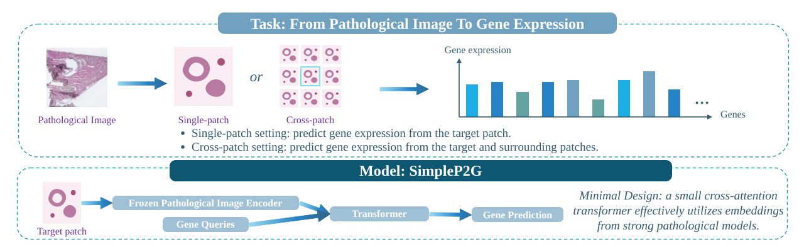

<h1 align="center">SimpleP2G: Importance of Image Encoders for Gene Expression Prediction from Pathology Images</h1>

<p align="center">
  <a href="https://personal-page.wjh.app/">Jinghao Wang</a><sup>1</sup>,
  <a href="https://zhangjj26.github.io/">Jingjie Zhang</a><sup>1</sup>,
  <a href="https://scholar.google.com/citations?user=K-AjhSgAAAAJ">Chang-Yu Hsieh</a><sup>2</sup>,<br>
  <a href="https://scholar.google.com/citations?user=BlSFT8UAAAAJ">Chunbin Gu</a><sup>1,✉</sup>,
  <a href="https://appsrv.cse.cuhk.edu.hk/~pheng/index.php">Pheng-Ann Heng</a><sup>1</sup>
</p>

<p align="center">
  <sup>1</sup> The Chinese University of Hong Kong &nbsp;
  <sup>2</sup> Zhejiang University &nbsp;
  <sup>✉</sup> <a href="mailto:gchb4science@gmail.com">Corresponding author</a>
</p>

<div align="center">
  <span>Paper (coming soon)</span> ·
  <a href="https://personal-page.wjh.app/SimpleP2G/">Project Page</a>
</div>

> **TL;DR** Start with a better image representation. A direct decoder on frozen pathology embeddings is already a strong baseline for spatial gene expression prediction.

<p align="center">
  
</p>

## 📄 Abstract

Pathology-image-to-gene-expression (P2G) studies often change the prediction head, image encoder, and spatial context together, making performance differences difficult to attribute. We examine these factors through paired image-input controls and explicit input regimes. Our main comparison covers five HEST-1K datasets, two 200-gene panels, and three selected held-out slides per dataset, using validation-selected checkpoints. Across all five datasets, replacing conventional image inputs with Virchow2 improves mean PCC-200 in 39 of 40 method--dataset--panel comparisons, while one comparison decreases. We introduce **SimpleP2G**, a direct gene-query decoder over frozen embeddings, and **SimpleP2G-cross**, which adds spatially positioned neighboring embeddings. With shared Virchow2 features, SimpleP2G has the highest single-patch mean PCC-200 on all five datasets under both panels; the cross-patch variant leads on four of five datasets under each panel. Decoder and context ablations show that greater depth and broader context do not consistently improve prediction. Together, these results suggest improving image representations before adding prediction-head complexity: a direct decoder over frozen pathology embeddings already provides a strong baseline. We hope our reimplemented image-encoder-upgraded baselines and SimpleP2G models serve as transparent, reproducible, and strong controls for future P2G research. 

<a id="installation"></a>

## 🛠️ Installation

Run from the repository root on **Linux with Python 3.12**. GPU runs use **PyTorch 2.10.0 with CUDA 12.8** and a compatible NVIDIA driver. [Pinned dependencies](requirements.txt)

```bash
python3.12 -m venv .venv
source .venv/bin/activate
python -m pip install --extra-index-url https://download.pytorch.org/whl/cu128 -r requirements.txt
python -m pip install --no-deps -e .
simplep2g-train --help
```

<a id="pretrained-models"></a>

## 🤗 Pretrained Models

The **10 single-patch checkpoints** cover five datasets and both gene panels
at fold 0 and seed 42. Each includes its ordered gene list and metadata. We
train for 100 epochs and select the EMA checkpoint by validation PCC-200.
[Hugging Face models](https://huggingface.co/king159/SimpleP2G)

Each head takes `(spots, 2560)` Virchow2 features. This example predicts the
first 16 spots on the Brain test slide. [Extract the features](docs/reproducibility.md#features-and-gene-panels)

```python
import torch
from src.pretrained import load_pretrained

model, genes, metadata = load_pretrained(
    "king159/SimpleP2G", dataset="brain", panel="hmhvg", device="cpu",
    revision="30e5a2403a420e793b0a8c9043901aeee01891f9",
)
embeddings = torch.load(
    "hest1k_datasets/brain/processed_data/1spot_virchow2_ebd/NCBI667_virchow2.pt",
    map_location="cpu", weights_only=True,
).float()
with torch.inference_mode():
    mean, log_variance = model(embeddings[:16])
# mean[:, i] predicts genes[i] in log2(raw_count + 1) units.
```

Download all ten heads for offline use.

```bash
hf download king159/SimpleP2G --revision 30e5a2403a420e793b0a8c9043901aeee01891f9 --local-dir checkpoints/SimpleP2G
```

Load the offline copy by passing `"checkpoints/SimpleP2G"` to `load_pretrained`.

## 🚀 Reproduce an experiment

Prepare the Brain cohort, Virchow2 embeddings, and fold-0 gene panels, then
run from the repository root. [Data and feature preparation](docs/reproducibility.md#data-and-weights)

```bash
python scripts/build_benchmark.py --cohort brain --fold 0 --method simplep2g --output results/brain-single
simplep2g-train --config results/brain-single/configs/brain_fold0_hmhvg_simplep2g_seed42.yaml
```

The run saves `final_predictions.npz` and `run_summary.json`. For SimpleP2G-cross
with 24 neighbors, use `--method simplep2g_cross` and a new output directory.

| Task | Guide |
| --- | --- |
| Train and evaluate the full benchmark | [Reproducibility guide](docs/reproducibility.md#training-and-checkpoint-selection) |
| Inspect budgets and splits | [Experiment configurations](configs/README.md) |
| Reproduce encoder swaps | [Reference inputs and caches](docs/encoders.md#reproduce-the-encoder-comparison) |


## 📊 Results and Downloads

| Download | Contents |
| --- | --- |
| [Main results CSV](docs/results/main-results.csv) | 300 fits across 10 models, 5 datasets, 2 panels, and 3 folds |
| [Encoder swaps CSV](docs/results/encoder-upgrades.csv) | 120 same-slide pairs comparing reference inputs with Virchow2 in four methods |

Both CSVs include unrounded metrics, split IDs, and selected epochs. Each
fold uses seed 42 and a separate validation slide for checkpoint selection.
[Columns and aggregation](docs/results/README.md)

With Virchow2 fixed, **SimpleP2G leads all 10 single-patch dataset–panel comparisons** in mean PCC-200. **SimpleP2G-cross leads 8 of 10**, with M2TGLGO ahead on PRAD HMHVG and ccRCC HVG.

| Dataset | SimpleP2G · HMHVG | SimpleP2G · HVG | SimpleP2G-cross · HMHVG | SimpleP2G-cross · HVG |
| --- | ---: | ---: | ---: | ---: |
| Brain | **0.4365 ± 0.1248** | **0.1722 ± 0.0620** | **0.4702 ± 0.1232** | **0.1964 ± 0.0463** |
| PRAD | **0.5138 ± 0.0914** | **0.2160 ± 0.0350** | 0.5541 ± 0.0974 | **0.2380 ± 0.0348** |
| HER2ST | **0.5078 ± 0.1998** | **0.2380 ± 0.1265** | **0.5423 ± 0.1906** | **0.2460 ± 0.1221** |
| Lung | **0.8592 ± 0.0127** | **0.4754 ± 0.0244** | **0.8791 ± 0.0100** | **0.4881 ± 0.0190** |
| ccRCC | **0.3508 ± 0.1458** | **0.1410 ± 0.0334** | **0.4490 ± 0.1023** | 0.1922 ± 0.0655 |

**PCC-200, mean ± sample SD across three test slides.** Bold marks the highest mean among all methods in the same input setting.

Switching to Virchow2 improves **39 of 40** dataset–method–panel means, with PCC changes from **−0.0118 to +0.3113**. BLEEP on Brain HMHVG is the exception. In the separate fold-0 SimpleP2G ablation, Virchow2 leads 7 of 10 comparisons, UNI leads 2, and DINOv2-L leads 1.
